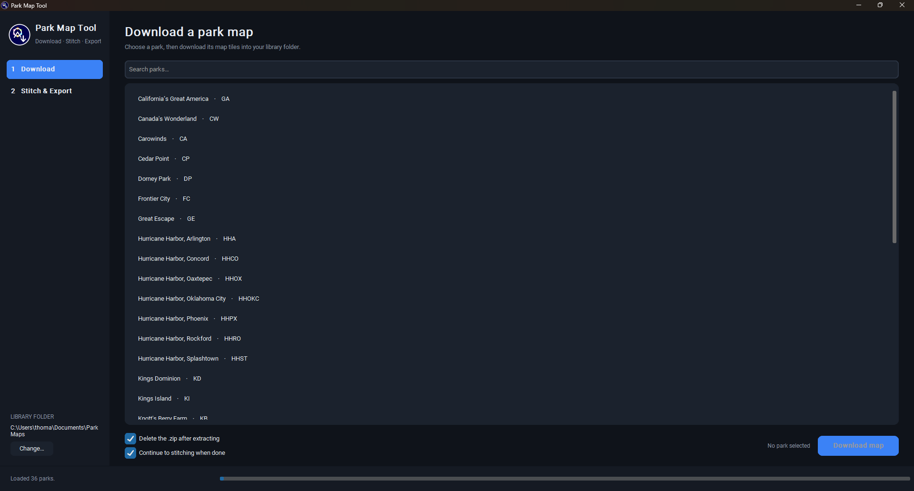

# Park Map Tool

<p align="center">
  
</p>

Park Map Tool is a desktop app for downloading and exporting high-resolution park maps for parks operated under the Six Flags and Cedar Fair families.

## Features

- Search and download interactive maps for supported parks.
- Choose from the zoom levels included in each downloaded map bundle.
- Preview the full map before exporting.
- Crop the export to the actual map area or keep the complete tile grid.
- Scale exports to 100%, 75%, 50%, or 25%.
- Export the stitched map as PNG, JPEG, WebP, TIFF, BMP, GIF, or PDF.
- Watch live export and memory information.
- Delete downloaded raw tiles after a successful export.
- Browse previously downloaded maps or open an existing map folder.
- Use a custom library and export folder.

## Screenshots



## Downloading

On the **Download** page:

1. Search for a park by name or abbreviation.
2. Select the park.
3. Choose whether to delete the downloaded `.zip` after extraction.
4. Choose whether to open **Stitch & Export** automatically.
5. Click **Download map**.

Downloaded maps are stored in `Documents\ParkMaps` by default. This location can be changed in the app.

## Stitching and exporting

On the **Stitch & Export** page:

1. Select a downloaded map or use **Browse...** to open another map folder.
2. Choose a zoom level.
3. Optionally reduce the scale.
4. Enable **Crop to map area** to remove empty tile-grid margins.
5. Select one or more export formats.
6. Set the quality for JPEG, WebP, or PDF exports if needed.
7. Choose an output folder.
8. Click **Export**.

By default, exported files are saved in an `exports` folder inside the downloaded map folder.

### Export formats

| Format | Notes |
| --- | --- |
| PNG | Lossless; streams to disk with low memory use |
| JPEG | `.jpg` output; configurable quality |
| WebP | Configurable quality; lossless when set to 100 |
| TIFF | Lossless; Adobe Deflate compression |
| BMP | Raw and uncompressed |
| GIF | 256-color palette |
| PDF | One-page output |

## Requirements

- Windows
- Python 3.10 or newer

The source uses:

- [CustomTkinter](https://github.com/TomSchimansky/CustomTkinter)
- Pillow
- Requests

## Project structure

```text
app.py              Desktop application and UI
assets/             Application logo and icon
mapkit/api.py       Park-list and map-bundle downloads
mapkit/common.py    Shared progress and cancellation helpers
mapkit/export.py    Image and document export implementations
mapkit/settings.py  Library-folder and preference storage
mapkit/stitch.py    Map manifest parsing and tile stitching
requirements.txt    Python dependencies
```

## Settings and data

The app stores its settings in:

```text
%APPDATA%\ParkMapTool\settings.json
```

The settings include the selected library folder and whether to open the export folder after completion.

## API note

Park discovery and map downloads use endpoints used by the parks' mobile-app ecosystem rather than a public, documented API. Those endpoints or the API key may change, so downloads can stop working until `mapkit/api.py` is updated.
